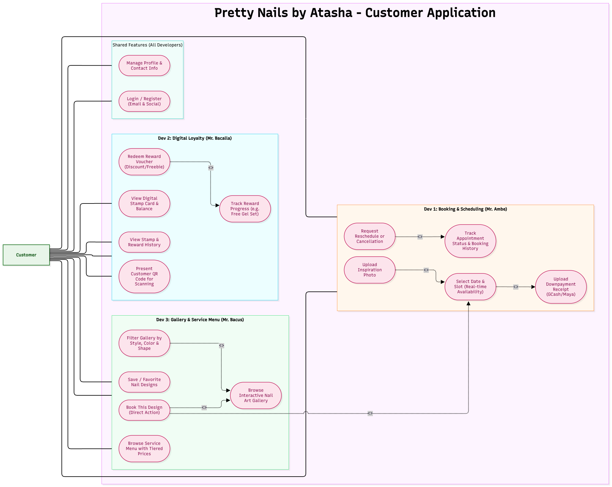
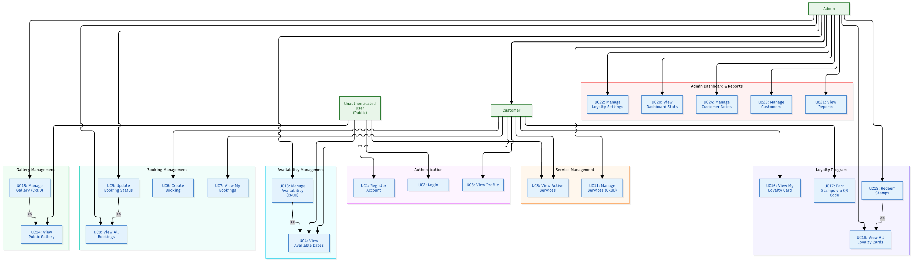
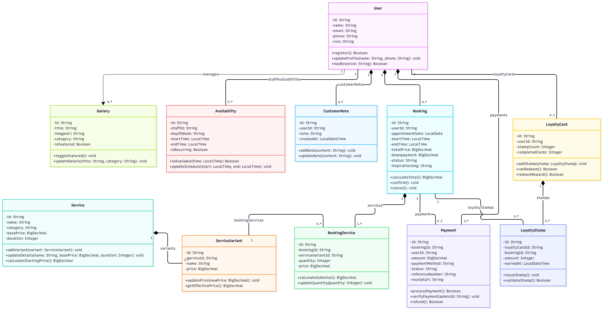
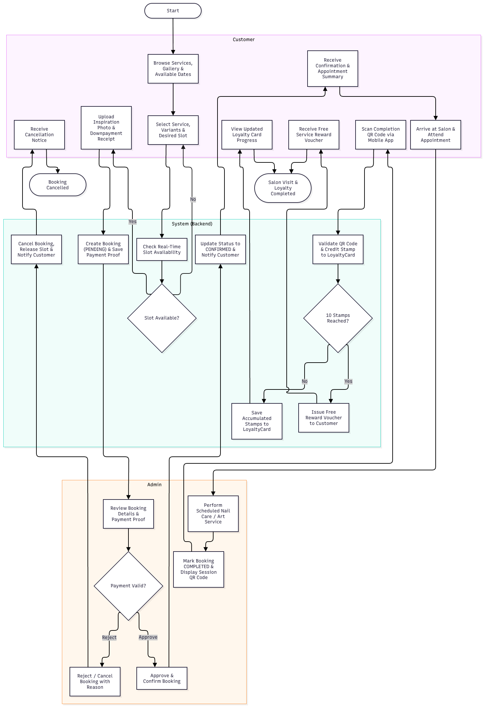
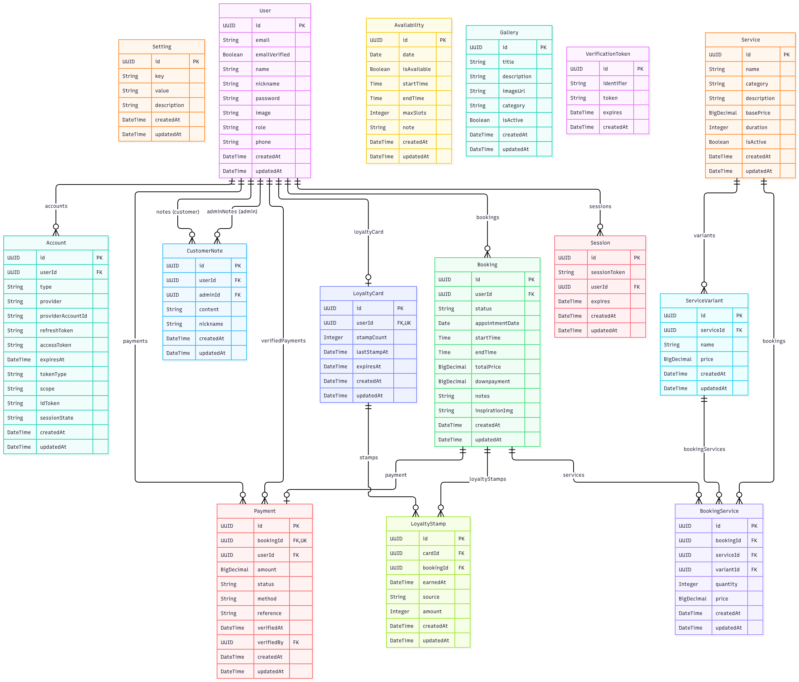

# Design Diagrams - Pretty Nails by Atasha

---

### 1. Standalone Customer Use-Case Diagram

---

### 2. System-Wide Use-Case Diagram

---

### 3. Simplified Domain Class Diagram

---

### 4. Simplified Activity Diagram (Customer Journey & Admin Flow)

---

### 5. Entity-Relationship Diagram (ERD)

